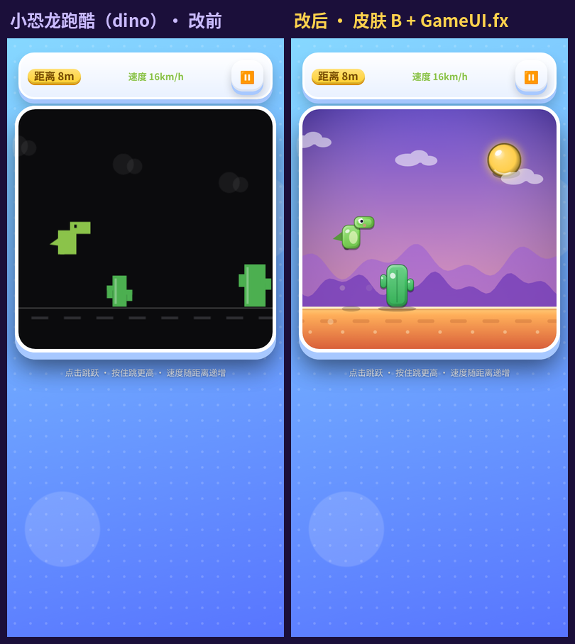
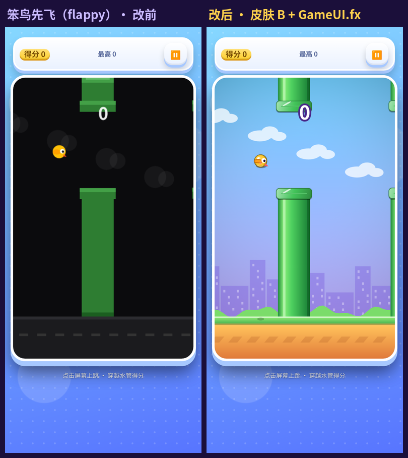
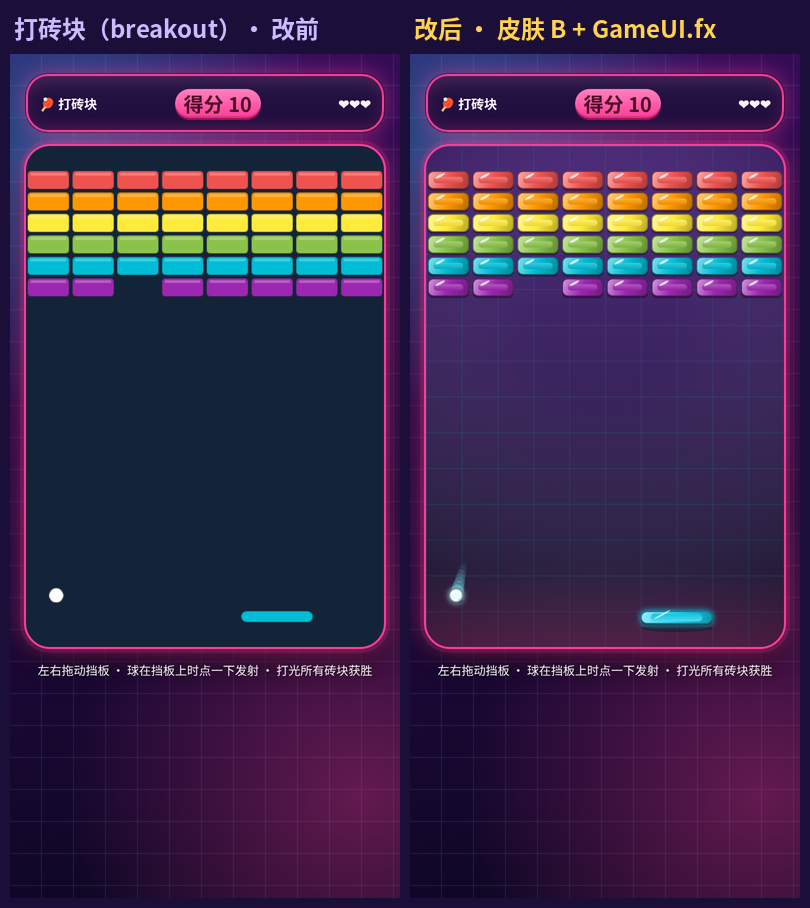
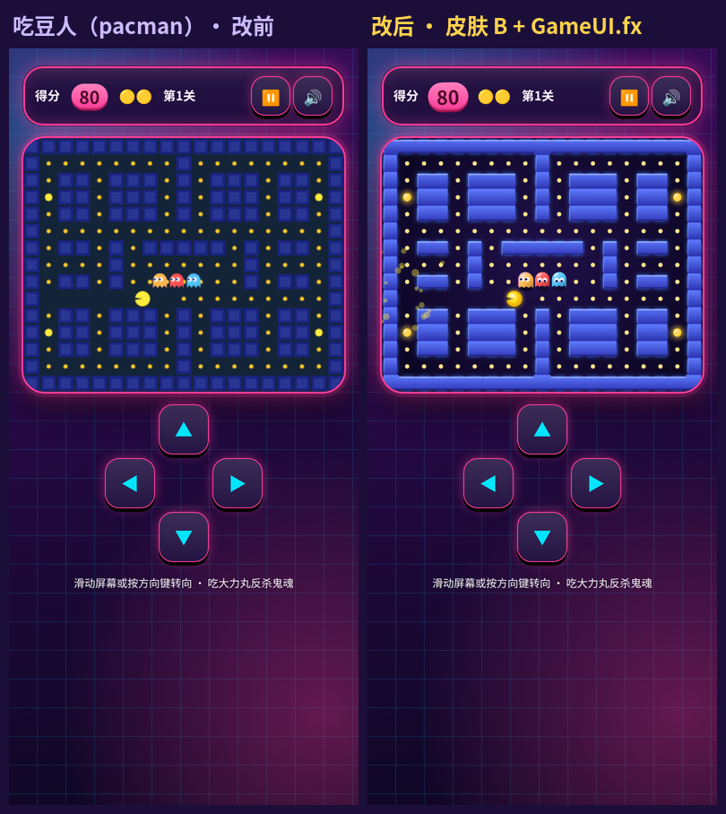
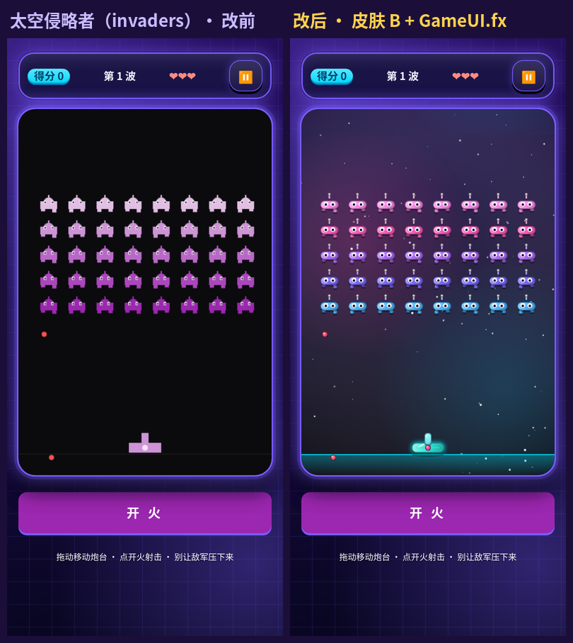
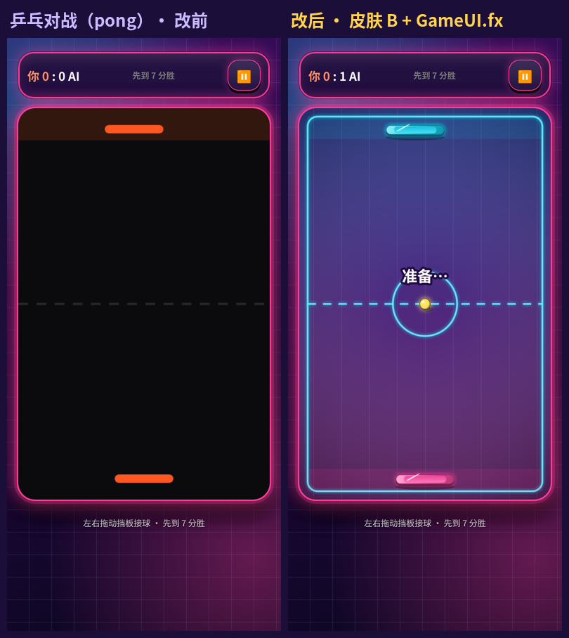
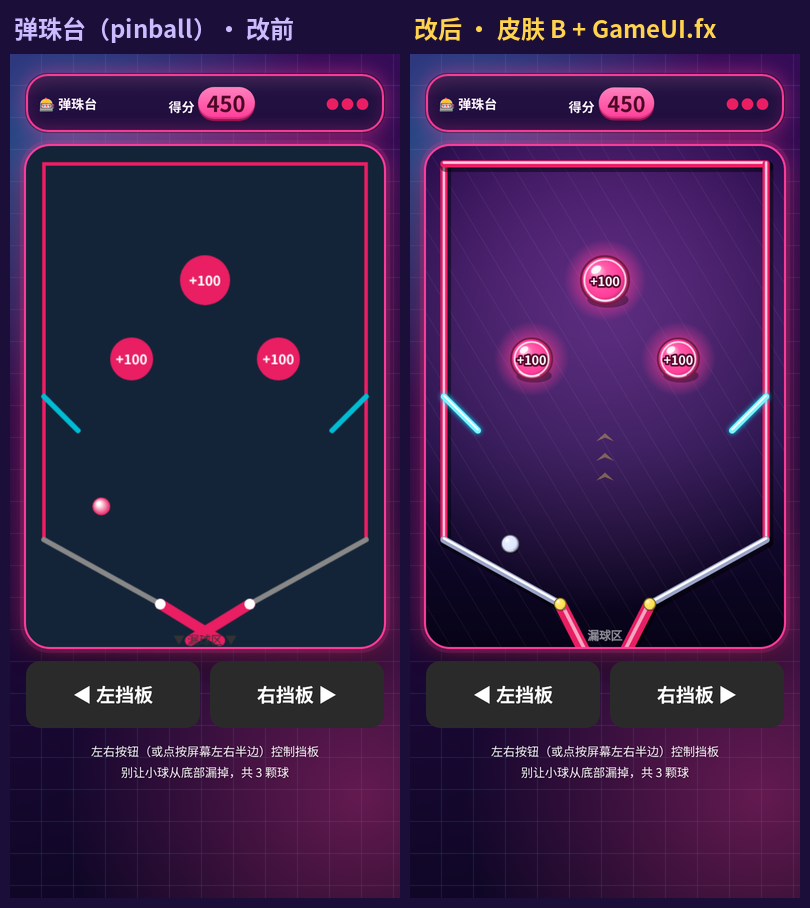
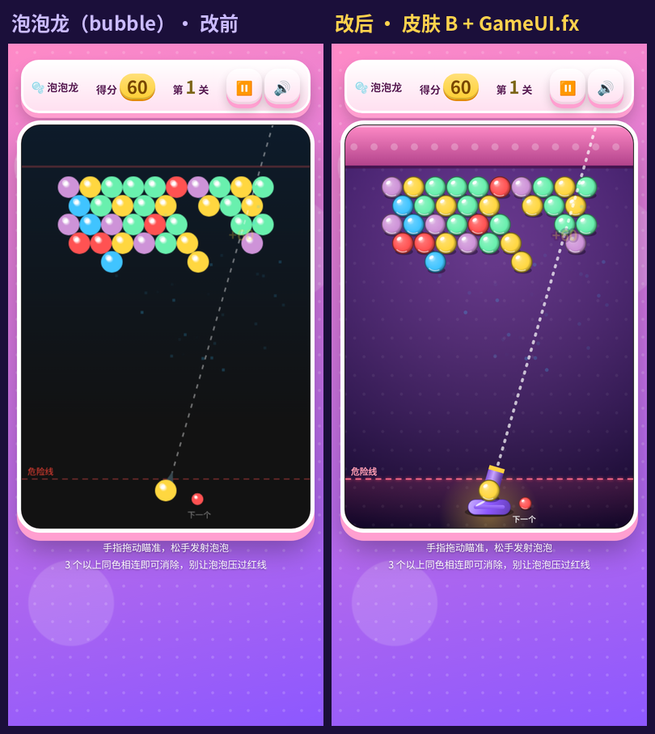
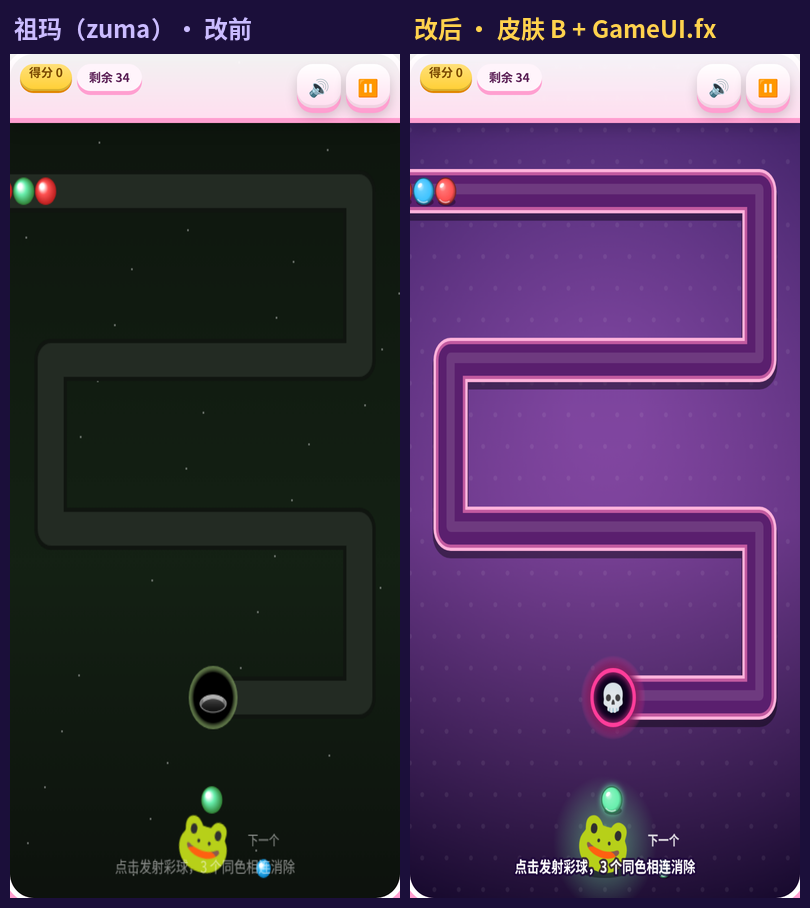

# 画面升级批次 T1-1（2026-10-21 制作，2026-10-22 推送）

第 3 步「画布画面升级」第一档第 1 批。原计划 10 款，实际推送 **9 款**（小行星剔除，见下）。批次表见 [皮肤 B 上线记录](ui-skin-b-2026-10-20.md)。

> **推送记录**：本批 10-21 做完并在本地测试通过，但当天定时任务没有完成提交推送。10-22 rebase 到最新 `origin/main` 后重新跑了全部测试再推送。
>
> **小行星（asteroid）本批剔除**：10-21 18:21 的提交 `8774542`「修复 #11：小行星改手势拖拽操作+自动开火」把 `games/asteroid` 整体换成了另一份旧版代码（560 行→189 行，没有共用界面块，`meta.json` 的 `version` 从 4 回到 2，`studio` 字段丢失）。本批的小行星画面改动是在旧代码上做的，和 #11 的新玩法冲突，强行合并会盖掉 #11 的修复，所以这次不改小行星，保留 `origin/main` 上的现状。等 #11 的版本补回皮肤 B 块、`studio` 和正确的版本号后，再在新代码上重做小行星的画面升级。

- 统一做法：画布内新增 `drawFx()`（祖玛是 `renderFx()`），全部用共享的 `GameUI.fx`：倒角糖果方块 `tile`、光泽球 `orb`、接触投影 `shadow`、渐变背景 `stage`、少量发光 `glow`、粒子 `burst`。
- 大块静态画面（迷宫、球台、轨道、地面、远景）只在第一次画进离屏 canvas，之后每帧一次 `drawImage`。
- `tile`、`orb` 的尺寸都取整数，颜色来自固定色表，缓存不会无限增长。
- 原来的平面 `draw()` 原样保留，没有 FX 时（`--skin=none`）作为兜底。
- 玩法、碰撞、计分、存档键都没改。下面「顺手修复」里的 3 个 bug 除外。
- 除祖玛外的 8 款（输入都按逻辑坐标换算）开了 `FX.hidpi` 高清；祖玛的输入本来就按逻辑坐标换算。
- 打砖块的 `toGame()` 从 `c.width` 改成逻辑 `W/H`，开 hidpi 后点击位置仍然准确。
- 每款 `meta.json` 的 `version` 相对 `origin/main` +1；`studio` 没改，9 款都是 `"Muse"`。
- zip 和 manifest 交给 Actions 生成，没有手改。

## 逐款改动

| 游戏 | id | 版本 | 画面改动 |
|---|---|---|---|
| 小恐龙跑酷 | dino | 5→6 | 晚霞渐变天空 + 发光太阳、两层视差紫色山丘、糖果沙地（条纹随速度滚动）；恐龙、仙人掌用倒角糖果块拼成，带肚皮高光、腮红和地面投影（跳得越高投影越小）；翼龙改成光泽球身；落地扬尘和奔跑尘土粒子 |
| 笨鸟先飞 | flappy | 5→6 | 晴空渐变 + 立体云朵、视差城市剪影和草坡；水管改为圆柱光照（左亮右暗 + 高光条），管口是倒角糖果块，地面有投影；小鸟用光泽球体 + 描边翅膀；每过一根水管出金色粒子；分数是描边大字 |
| 打砖块 | breakout | 5→6 | 霓虹网格台面 + 底部粉色光带；砖块是倒角糖果块（双血砖带白框）；挡板发青色光，有投影；球是发光光泽球 + 拖尾；碎砖时按砖色爆粒子 |
| 吃豆人 | pacman | 4→5 | 迷宫预渲染：霓虹外发光 + 立体墙体，相连的墙合并，顶部亮边、底部暗边；大力丸是脉动的发光金球；鬼魂有渐变体、高光、投影和裙摆抖动；吃豆人用径向渐变 + 发光；飘字描边 |
| 太空侵略者 | invaders | 5→6 | 星云 + 慢速滚动星空；敌人是 7 色糖果机器人（倒角机身、天线光点、大眼睛）；炮台发青光；子弹是发光胶囊，敌弹是红色光泽球；击毁和中弹时爆粒子；底部防线有光带 |
| 乒乓对战 | pong | 5→6 | 霓虹球场：蓝紫渐变 + 暗角、发光边线、中线和中圈，两端有阵营色区；双方挡板是倒角发光块（AI 青色，玩家粉色），有投影；球是发光金球 + 拖尾；击球时爆粒子 |
| 弹珠台 | pinball | 5→6 | 球台预渲染：紫色台面聚光 + 斜纹、立体导轨（投影 + 高光）、目标底座光圈、箭头灯；弹射器发青光；三个 +100 目标是光泽球，被撞时变金色并发光、爆粒子；挡板有投影，按下时发光，轴心是金色球；弹珠是银色光泽球 |
| 泡泡龙 | bubble | 4→5 | 糖果紫台面 + 波点、粉色顶板；泡泡全部换成光泽球；发射器是渐变炮管 + 糖果底座 + 投影；瞄准线改为圆点虚线；危险线发光；飞行中的泡泡发光；飘字描边 |
| 祖玛 | zuma | 4→5 | 紫色波点背景；轨道预渲染成立体凹槽（投影、粉色边、深槽、内高光）；洞口是发光骷髅门；彩珠全部换成光泽球；青蛙脚下有投影和光圈；待发射的珠子发光 |

## 触控与布局修复（≥44px，不滚动）

- **按钮小于 44px**：吃豆人（`#pauseBtn`、`#sndBtn`）、泡泡龙（`#pauseBtn`、`#soundBtn`）、祖玛（`#pauseBtn`、`#soundBtn`）。
  - 原因：游戏自带 38～40px，加上共用 `base.css` 在 360 宽时把 `.iconbtn` 的最小宽度设为 40px。
  - 做法：在游戏自己的样式里用 `html.game-ui #id{min-width:44px;min-height:44px}` 覆盖。共用 CSS 没动，所以不影响其他游戏。
- **360×640 要滚动**：笨鸟先飞、乒乓对战（各 11px）、太空侵略者（36px）、弹珠台（34px）。
  - 做法：画面宽度按视口高度收窄，`max-width:min(原值, calc((100svh - N)*k))`，前面先写一条 `vh` 的兜底。
  - 现在 4 款都是 0px。390×844 下宽度不变，仍是 358px。

## 顺手修复的 3 个 bug

这 3 个都会让「一局玩不完」，所以一起修了。

1. **乒乓对战：首球消失。**
   - 原因：`serveBall()` 只设置了 `vx/vy`，倒计时结束后却去读 `ball._vx/_vy`，这两个值没赋过，球速变成 NaN。
   - 后果：开局就看不到球，比分永远 0:0（见对比图左侧）。
   - 修复：在 `serveBall()` 里补一行 `ball._vx=ball.vx;ball._vy=ball.vy;`。
2. **弹珠台：球永远漏不掉。**
   - 原因：两块挡板的静止角是 0.55，尖端在中间交叉成 V 形，球会停在 V 里，游戏永远不会结束。
   - 修复：静止角改为 1.1（挡板下垂），两个尖端之间留出约 30px 的漏球口。按下时的角度、挡板长度和击球力度都没变。
   - 实测：不操作时 3 颗球约 13 秒漏完，游戏结束；用脚本按时挥板，玩 180 秒还剩 2 颗球，得分 3630。
3. **祖玛：输了不出结算面板。**
   - 原因：链条进洞时调用的 `noise()` 没有定义，会抛 ReferenceError，结算面板出不来。
   - 修复：补上用 WebAudio 合成的 `noise()`，同样遵守静音开关。

## 对比图（390×844，同一随机种子，改前左、改后右）

| | |
|---|---|
|  |  |
|  |  |
|  |  |
|  |  |
|  | |

## 测试结果（10-22 rebase 到最新 origin/main 后重跑，9 款）

- `node scripts/check-game.cjs dino,flappy,breakout,pacman,invaders,pong,pinball,bubble,zuma`：两种尺寸 18/18 PASS。
- 无头浏览器整局测试（Playwright 假时钟；点开始→暂停→继续→玩到结算→再来一局）：390×844 和 360×640 都是 18/18 PASS，控制台无报错，开局前、结束后滚动量都是 0。
- `node scripts/sync-game-ui.cjs --check --strict --only=<本批 9 款>`：Verified 9，退出码 0。
  - 不加 `--only` 的全量检查在 `origin/main` 上本来就失败（和本批无关）：asteroid、billiards、collapse、ninja、slingshot 的共用界面块过期（10-21 的修复 #11～#16 用旧代码覆盖了这几款），gunslinger、lasso 没在 catalog 登记。
- `node scripts/build-classic-games.cjs --check`：五款 Verified。
- `node scripts/test-classic-games.cjs`：10/10 PASS。
- `node scripts/test-gameplay.cjs`：breakout 两种模式（classic、expert）都 PASS（挡板 80/60、砖块护甲 1/2、48 块砖）。
  - 整个脚本在 game2048 就失败；跳过 game2048、minesweeper 后，snake、tetris、breakout、solitaire、simon、towerdef 都通过，然后停在 gomoku（`aiMove is not defined`）。这三款都被可玩性升级第 1 批改写了，测试脚本还是旧接口，跟本批无关。

## 10-21 的原始测试记录（10 款，含小行星）

**`node scripts/check-game.cjs`（10 款）**

- 两种尺寸 20/20 PASS。
- 改前在 360×640 下有 8 项 FAIL：4 款按钮小于 44px，4 款页面溢出。

**无头浏览器整局测试**

- 测试方式：
  - 用 Playwright 假时钟快进；
  - 先点开始，再暂停、继续；
  - 用简单输入玩到结算面板出现，再点「再来一局」，确认能重新开局。
- 改后：
  - 390×844 和 360×640 都是 20/20 PASS；
  - 控制台无报错；
  - 两种尺寸开局前、结束后的滚动量都是 0。
- 改前对比：
  - 乒乓对战、弹珠台在 460 秒游戏时间内都结束不了，原因见上面的 bug；
  - 祖玛在链条进洞时报 `ReferenceError: noise is not defined`，结算面板出不来；
  - 笨鸟先飞、太空侵略者、乒乓对战、弹珠台在 360×640 下要滚动。

**仓库检查**

- `node scripts/sync-game-ui.cjs --check --strict`：Verified 256。
- `node scripts/build-classic-games.cjs --check`：五款 Verified。
- `node scripts/test-classic-games.cjs`：10/10 PASS。
- `node scripts/test-gameplay.cjs`：本批相关的 breakout 两种模式（classic、expert）都 PASS。
  - 其中挡板宽 80/60、砖块护甲 1/2、48 块砖都符合预期。
  - 整个脚本在 game2048 那一项就失败了，紧接着的 minesweeper 也会失败。原因是这两款今天已被可玩性升级第 1 批改写，测试脚本还是旧接口，跟本批无关。
  - 跳过 game2048 后，snake、tetris、breakout 都通过，然后停在 minesweeper。
