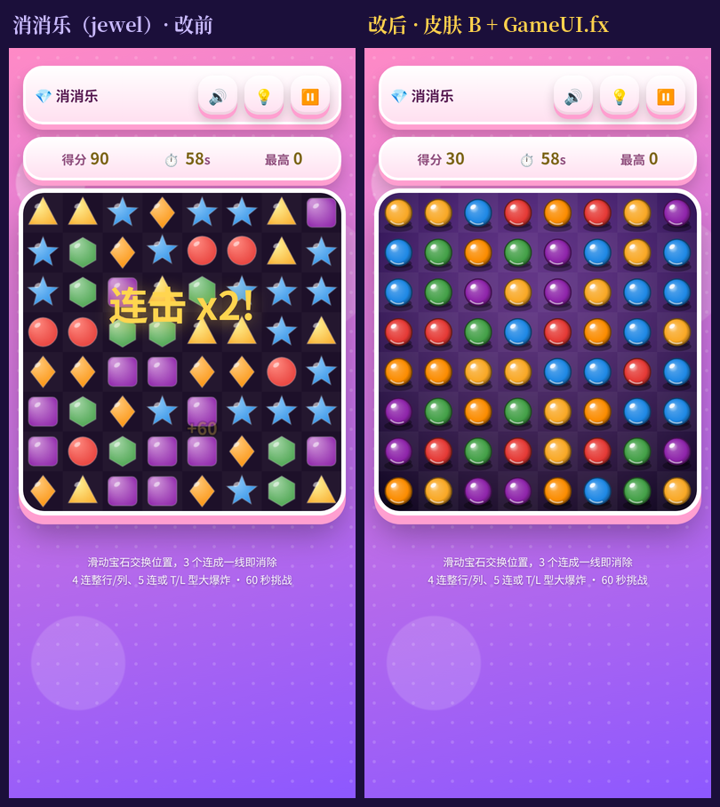
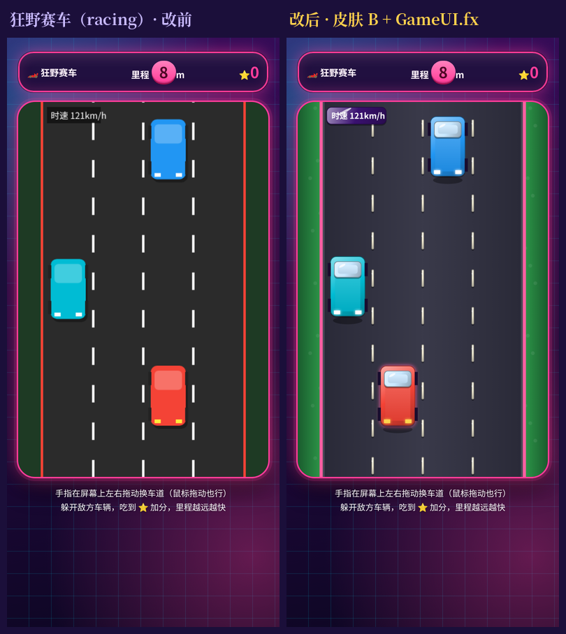
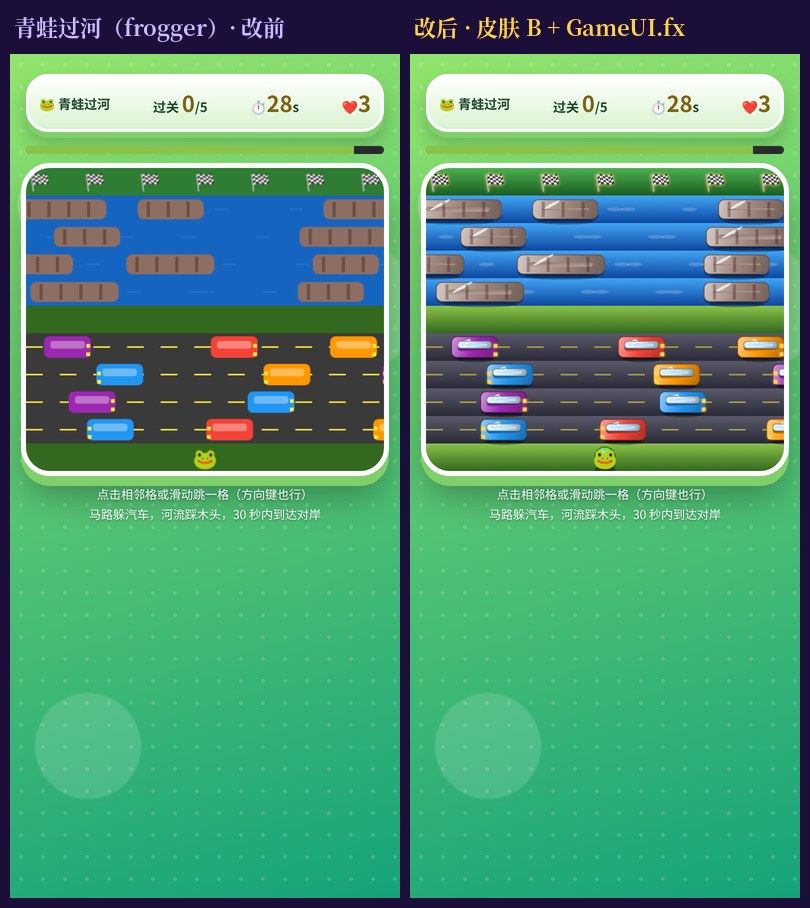
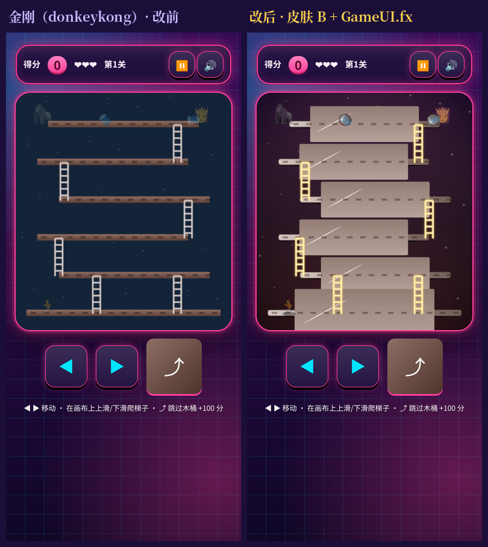
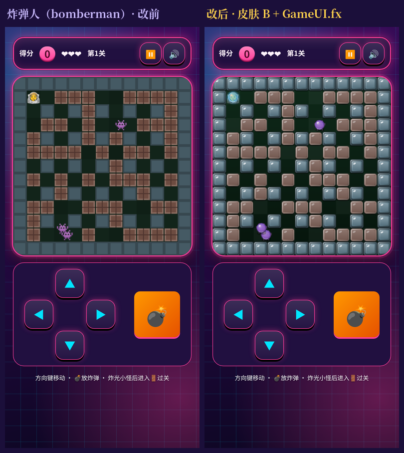
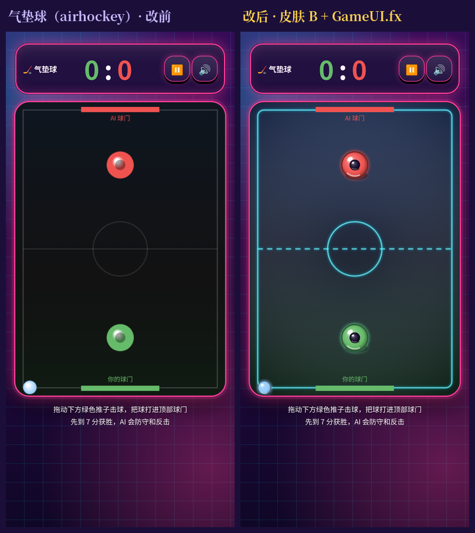
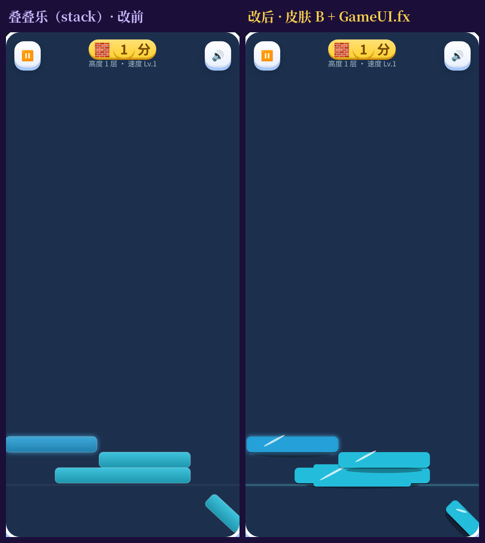
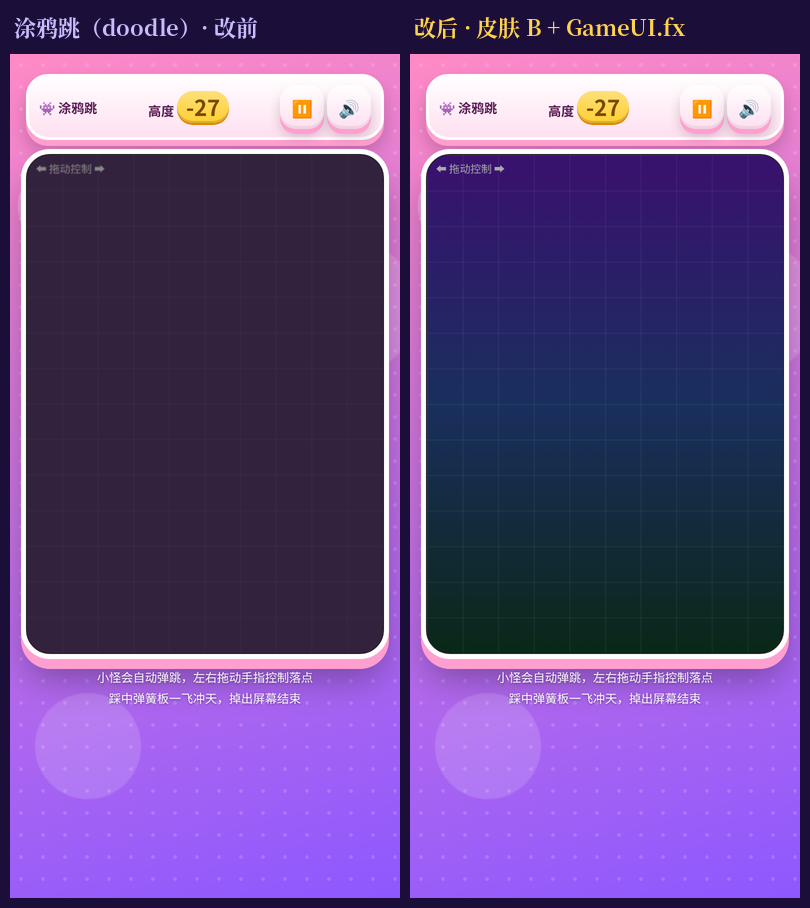
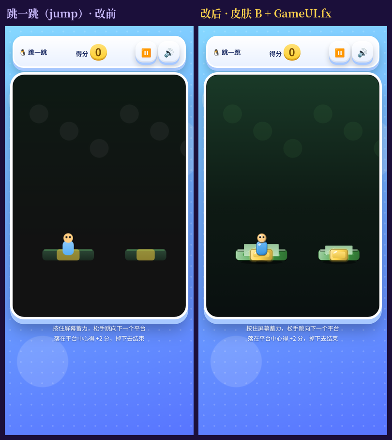
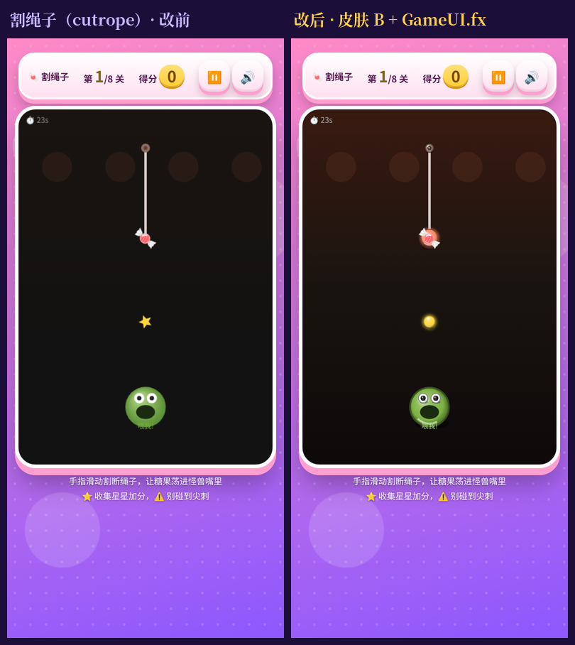

# 画面升级批次 T1-2（2026-10-23）

第 3 步「画布画面升级」第一档第 2 批。10 款全部完成。批次表见 [皮肤 B 上线记录](ui-skin-b-2026-10-20.md)。

- 统一做法：画布内新增 `drawFx()`（消消乐是 `renderFx()`），全部用共享的 `GameUI.fx`：倒角糖果方块 `tile`、光泽球 `orb`、接触投影 `shadow`、渐变背景 `stage`、少量发光 `glow`、粒子 `burst`。
- 大块静态画面（棋盘底、公路、台面、水域/河岸、冰球场）只在第一次画进离屏 canvas，之后每帧一次 `drawImage`。
- `tile`、`orb` 的尺寸都取整数，颜色来自固定色表，缓存不会无限增长。
- 原来的平面 `draw()` / `render()` 原样保留，没有 FX 时（`--skin=none`）作为兜底。
- 玩法、碰撞、计分、存档键都没改。
- 输入已按逻辑坐标换算的款开了 `FX.hidpi`；叠叠乐本身在 `fit()` 里按 DPR 改 canvas，**没有**再调 `FX.hidpi`。
- 每款 `meta.json` 的 `version` 相对 `origin/main` +1；`studio` 没改，10 款都是 `"Muse"`。
- zip 和 manifest 交给 Actions 生成，没有手改。

## 逐款改动

| 游戏 | id | 版本 | 画面改动 |
|---|---|---|---|
| 消消乐 | jewel | 5→6 | 棋盘底预渲染（霓虹网格 + 渐变）；宝石改光泽球 + 投影；选中虚线环、提示描边、飘字描边；`renderFx` + `FX.hidpi` |
| 狂野赛车 | racing | 5→6 | 公路底预渲染；车道虚线糖果块；车辆倒角机身 + 挡风玻璃块 + 车灯发光；星星光泽球；里程牌；撞车粒子 |
| 青蛙过河 | frogger | 5→6 | 河/岸/路分区渐变；木头/汽车糖果块 + 投影；青蛙光泽球；终点旗发光；`drawFx` |
| 金刚 | donkeykong | 4→5 | 平台预渲染条；梯子描边；木桶光泽球；玩家糖果块 + 投影；金刚/公主 emoji 发光；粒子光泽球 |
| 炸弹人 | bomberman | 4→5 | 墙/软砖倒角块；炸弹脉动光泽球；爆炸火焰块；玩家/敌人光泽球 + 投影；出口发光；地图格整数尺寸 |
| 气垫球 | airhockey | 5→6 | 冰球场预渲染；球拍光泽球 + 发光环；冰球发光球 + 投影；进球粒子与飘字 |
| 叠叠乐 | stack | 4→5 | 塔块倒角糖果块 + 投影 + 完美发光；切割下落块同材质；地面青光线；**不**额外 `hidpi`（`fit()` 已按 DPR） |
| 涂鸦跳 | doodle | 4→5 | 平台糖果块（移动台蓝色）；弹簧块；角色绿身 + 白眼光泽球 + 天线；粒子光泽球 |
| 跳一跳 | jump | 4→5 | 台面绿块 + 中心金靶；角色蓝身 + 肤色头；蓄力环发光；粒子光泽球 |
| 割绳子 | cutrope | 5→6 | 绳子描边；锚点双层球；尖刺红光；星星金光泽球；糖果橙光泽球 + 拖尾；怪物绿脸光泽球 |

## 触控与布局修复（≥44px，不滚动）

- **按钮小于 44px**（360 宽时共用 CSS 把 `.iconbtn` 最小宽度压到 40px）：
  - 消消乐：`#pauseBtn`、`#muteBtn`、`#hintBtn`
  - 金刚 / 炸弹人：`#pauseBtn`、`#sndBtn`
  - 气垫球 / 涂鸦跳 / 跳一跳 / 割绳子：`#pauseBtn`、`#soundBtn`
  - 叠叠乐：`#pauseBtn`、`#muteBtn`
  - 做法：游戏本地 `html.game-ui #id{min-width:44px;min-height:44px}`，共用 CSS 未改。
- **360×640 溢出**：炸弹人改前 y+30；把 `#cv` 收窄为 `max-width:min(440px,calc((100svh - 340px)*1))`（并保留 `vh` 兜底）。其余款按 T1-1 同款公式预留了 canvas `max-width` calc。

## 对比图（390×844，同一随机种子，改前左、改后右）

| | |
|---|---|
|  |  |
|  |  |
|  |  |
|  |  |
|  |  |

## 测试结果（2026-10-23）

- `node scripts/check-game.cjs jewel,racing,frogger,donkeykong,bomberman,airhockey,stack,doodle,jump,cutrope`：两种尺寸 **20/20 PASS**。
  - 修前 360×640：消消乐（mute/hint &lt;44px）、金刚（sndBtn）、炸弹人（sndBtn + 溢出 y30）FAIL；本地 CSS 覆盖后全部 PASS。
- 无头浏览器整局测试（Playwright 假时钟；点开始→暂停→继续→触发结算→再来一局）：390×844 和 360×640 **20/20 PASS**，控制台无报错，开局前、结束后滚动量都是 0。
- `node scripts/sync-game-ui.cjs --check --strict --only=jewel,racing,frogger,donkeykong,bomberman,airhockey,stack,doodle,jump,cutrope`：Verified 10，退出码 0。
- `node scripts/build-classic-games.cjs --check`：五款 Verified。
- `node scripts/test-classic-games.cjs`：10/10 PASS。
- 本批无 `test-gameplay.cjs` 覆盖的 id，未跑该脚本的相关断言。
