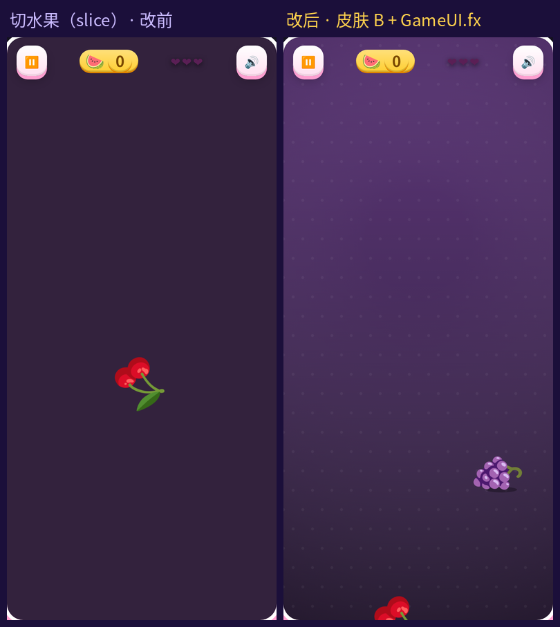
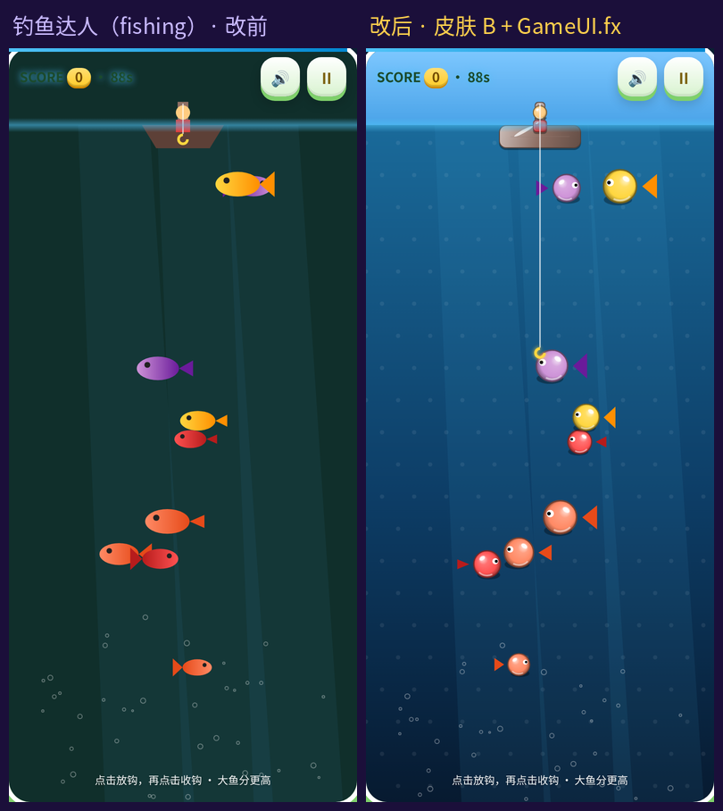
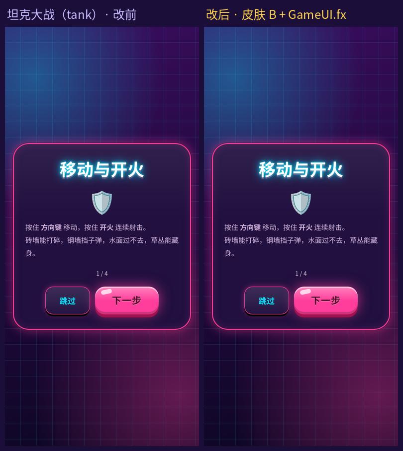
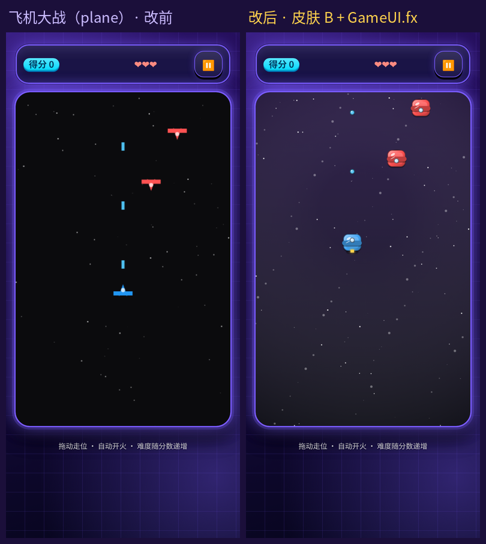
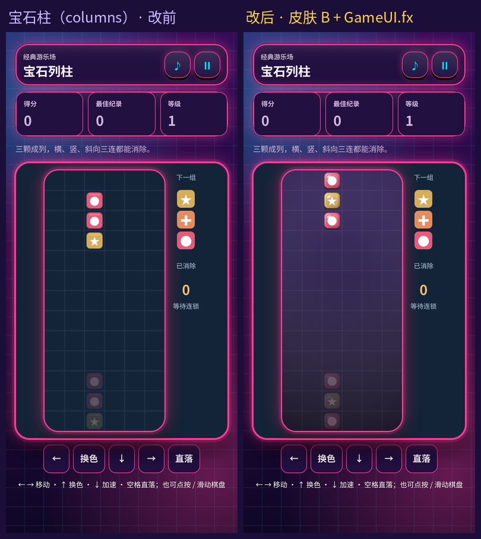
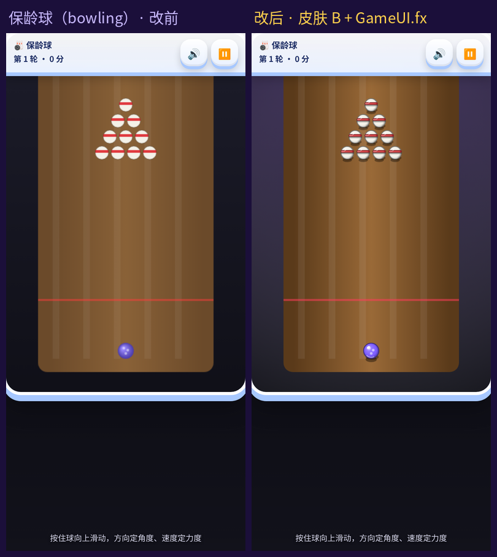
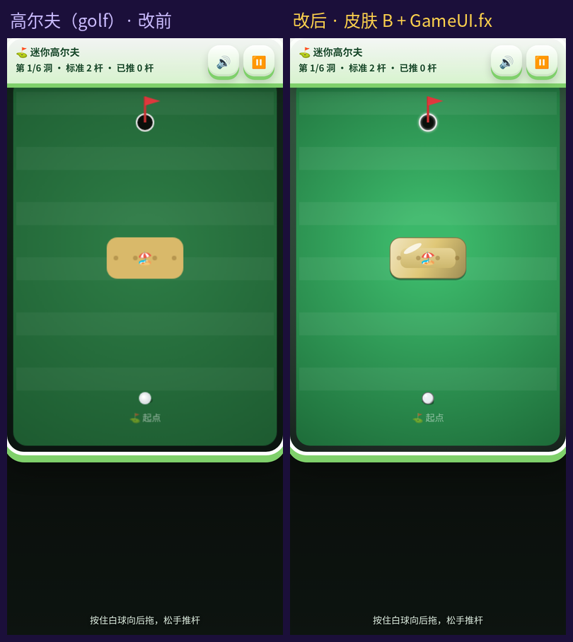
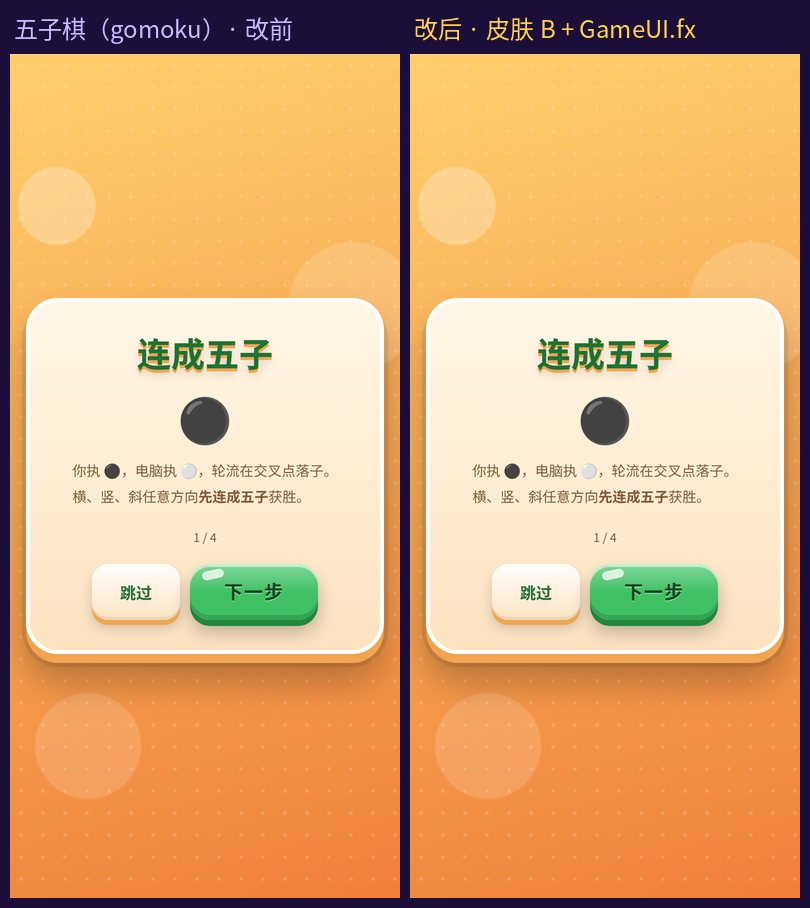
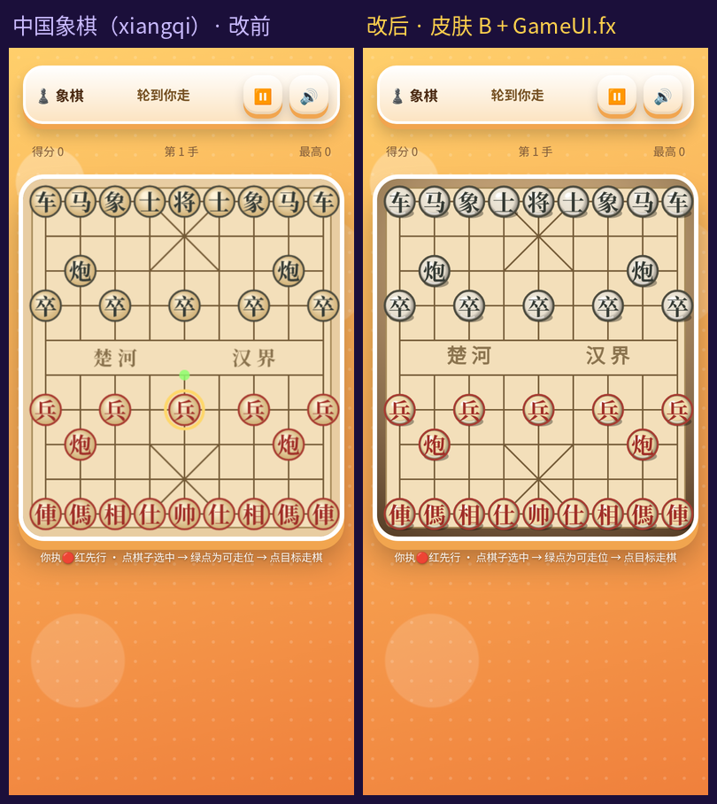
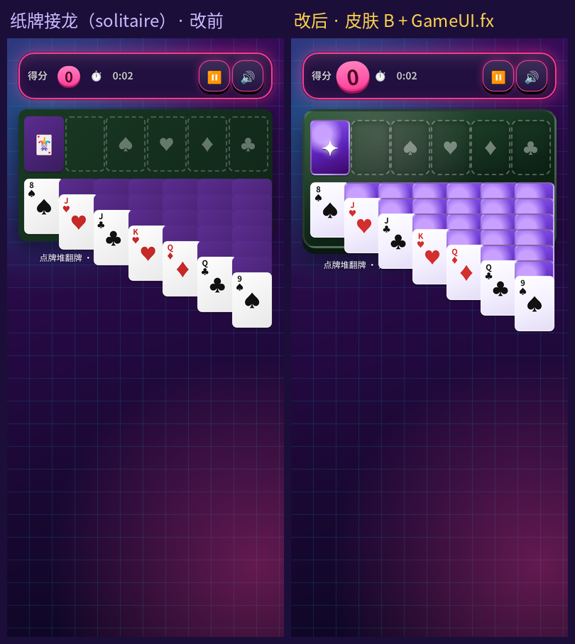

# 画面升级批次 T1-3（2026-10-24）

第 3 步「画布画面升级」第一档第 3 批。10 款全部完成。批次表见 [皮肤 B 上线记录](ui-skin-b-2026-10-20.md)。

- 统一做法：画布内新增 `drawFx()`（宝石柱在经典生成器里走 FX 分支），全部用共享的 `GameUI.fx`：倒角糖果方块 `tile`、光泽球 `orb`、接触投影 `shadow`、渐变背景 `stage`、少量发光 `glow`、粒子 `burst` / `drawBurst`。
- 大块静态画面（夜空、水域、球道、草地、棋盘底、战场底）只在第一次画进离屏 canvas，之后每帧一次 `drawImage`。
- `tile`、`orb` 的尺寸都取整数，颜色来自固定色表，缓存不会无限增长。
- 原来的平面 `draw()` / `render()` 原样保留，没有 FX 时（`--skin=none`）作为兜底。纸牌接龙以 DOM 立体卡片为主，FX 仅用于通关粒子。
- 玩法、碰撞、计分、存档键都没改。
- 输入已按逻辑坐标换算的款开了 `FX.hidpi`；切水果 / 钓鱼本身在 `fit()` / `resize()` 里按 DPR 改 canvas，**没有**再调 `FX.hidpi`。坦克、五子棋此前已接 FX，本批补离屏底图 / 触控布局。
- 每款 `meta.json` 的 `version` 相对本批前 +1；`studio` 没改，10 款都是 `"Muse"`。
- 宝石柱来自 `scripts/classics/columns.cjs`，同步把 `CLASSIC_VERSION` 3→4，重建五款经典（connectfour / colorlines / yahtzee / columns / pyramid）的 `meta.version` 一并 +1。
- zip 和 manifest 交给 Actions 生成，没有手改。

## 逐款改动

| 游戏 | id | 版本 | 画面改动 |
|---|---|---|---|
| 切水果 | slice | 5→6 | 夜空底预渲染；水果投影；刀光 `glow`；`drawFx`；**不**额外 `hidpi`（`fit()` 已按 DPR） |
| 钓鱼达人 | fishing | 4→5 | 水面/天空预渲染；船/竿糖果块；鱼光泽球 + 投影；鱼钩发光；**不**额外 `hidpi` |
| 坦克大战 | tank | 6→7 | 已有 FX；本批加战场底离屏预渲染；触控/布局收窄 |
| 飞机大战 | plane | 5→6 | 星空底预渲染；战机/敌机糖果机身 + 挡风球 + 尾焰发光；子弹光泽球；`FX.hidpi` |
| 宝石柱 | columns | 3→4 | 经典生成器：棋盘底预渲染 + 霓虹网格；宝石倒角块；`FX.hidpi`；`CLASSIC_VERSION`→4 |
| 保龄球 | bowling | 4→5 | 球道底预渲染；瓶/球光泽球 + 投影；瞄准线发光；`FX.hidpi` |
| 高尔夫 | golf | 4→5 | 草地底预渲染；沙坑/水面糖果块；球光泽球；洞口/瞄准发光；飘字保留；`FX.hidpi` |
| 五子棋 | gomoku | 6→7 | 已有 FX（棋子 orb / 禁手块 / 连线 glow）；本批触控 ≥44px + canvas max-width |
| 中国象棋 | xiangqi | 4→5 | 棋盘底预渲染；棋子光泽球 + 投影；选中发光环；`FX.hidpi` |
| 纸牌接龙 | solitaire | 4→5 | DOM 立体卡面（渐变桌布、倒角投影卡背 ✦）；通关 `winFx` 用 `burst`/`orb`；无主画布 hidpi |

## 触控与布局修复（≥44px，不滚动）

- **按钮小于 44px**（360 宽时共用 CSS 把部分 `.iconbtn` 压到 40px）：
  - 切水果 / 钓鱼 / 象棋：`#pauseBtn`、`#muteBtn`
  - 坦克：`#pauseBtn`、`#fireBtn`
  - 飞机：`#pauseBtn`
  - 保龄 / 高尔夫：`#pz`、`#snd`
  - 五子棋：`#pauseBtn`、`#aidHint`、`#aidUndo`
  - 纸牌：`.iconbtn` 强制 44×44
  - 做法：游戏本地 `html.game-ui #id{min-width:44px;min-height:44px}`，共用 CSS 未改。
- **360×640 溢出**：按 T1-1/T1-2 同款公式给 canvas 加了 `max-width:min(...,calc((100svh - Npx)*ratio))`（并保留 `vh` 兜底）。宝石柱沿用经典 frame 的 `min(52svh,460px)`。

## 对比图（390×844，改前左、改后右）

| | |
|---|---|
|  |  |
|  |  |
|  |  |
|  |  |
|  |  |

## 测试结果（2026-10-24）

- `node scripts/check-game.cjs slice,fishing,tank,plane,columns,bowling,golf,gomoku,xiangqi,solitaire`：两种尺寸 **20/20 PASS**。
- 无头浏览器整局测试（Playwright；点开始→关卡/教程→暂停→继续→触发结算→再来一局）：390×844 和 360×640 **20/20 PASS**，控制台无报错，滚动量相对改前基线 Δ≤0。
- `node scripts/sync-game-ui.cjs --check --strict --only=slice,fishing,tank,plane,columns,bowling,golf,gomoku,xiangqi,solitaire`：Verified 10，退出码 0。
- `node scripts/build-classic-games.cjs --check`：五款 Verified。
- `node scripts/test-classic-games.cjs`：10/10 PASS。
- `test-gameplay.cjs` 本批相关断言：solitaire×2、gomoku×2、xiangqi×1 **5/5 PASS**。（全量脚本在无关的 snake 上因既有问题失败，未纳入本批门槛。）
