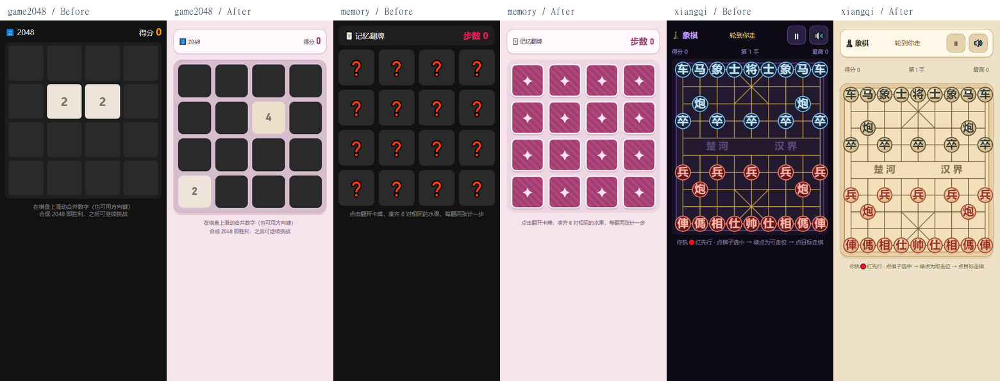

# 141 款子游戏界面与进阶挑战更新

日期：2026-10-16

这次覆盖 games/ 下全部 141 款。每款保留经典模式，并增加可选进阶挑战；在开局卡片上切换模式，重新加载后生效。进阶纪录与经典纪录分开，原有经典存档不迁移，音效设置共用。

界面统一处理了开局/暂停/结算层次、中文标题、分数可读性、触控按钮、键盘焦点、减少动态效果偏好，并按题材分成九组配色。透明画布保留深色舞台，避免白色游戏线条消失。解谜类在进阶模式下每次挑战最多使用一次提示、三次撤销（仅对具有这些操作的游戏生效）；重新开始一局会恢复额度。

有些进阶升级属于资源、时间、容错或判定窗口调整；新增机制包括贪吃蛇固定障碍、俄罗斯方块障碍行与落点预览、打砖块护甲、纸牌接龙三张翻牌、塔防装甲敌人、记忆节拍双音符增长，以及五子棋/象棋的应手评估。

## 逐款改动

| 游戏 | 界面调整 | 进阶规则 |
| --- | --- | --- |
| 气垫球 (airhockey) | 街机主题：深蓝舞台、琥珀色主按钮与独立操控区 | 电脑防守步速提升至 6.2，更考验反弹角度 |
| 外星密语 (alienlang) | 蓝白解谜桌面：深蓝文字、浅色工具栏与清晰选中态 | 每次挑战仅 1 次提示、3 次撤销，谨慎规划再落子 |
| 神射手 (archery) | 街机主题：深蓝舞台、琥珀色主按钮与独立操控区 | 移动靶半径缩至 48，10 支箭挑战精准命中 |
| 小行星 (asteroid) | 太空主题：藏蓝背景、薄荷色按钮与高对比仪表 | 仅有 2 条命，保留原有三级小行星碎裂与 UFO |
| 极光 (aurora) | 重做相机快门边框和能量条 | 峰值偏差扣分加倍，5 次快门需要更准的时机 |
| 八卦转轮 (bagua) | 木色棋桌：砂金棋盘、深绿按钮、楷体标题 | 每次挑战仅 1 次提示、3 次撤销，谨慎规划再落子 |
| 打气球 (balloon) | 莓粉游乐主题：浅色面板、柔和按钮与独立游戏舞台 | 炸弹误击扣分提高到 40，先辨目标再出手 |
| 滚珠入洞 (ballroll) | 晴空蓝主题：浅蓝背景、深蓝主操作与运动计分栏 | 小球惯性更强，摩擦降至 1.2；提示仅 1 次 |
| 海战棋 (battleship) | 海蓝网格、舰船/水花/命中状态层次 | 每次挑战仅 1 次提示、3 次撤销，谨慎规划再落子 |
| 便当拼装 (bento) | 木色便当盒、食材区与可换行工具栏 | 每次挑战仅 1 次提示、3 次撤销，谨慎规划再落子 |
| 大鱼吃小鱼 (bigfish) | 青绿自然主题：浅绿界面、深色场地与独立操作栏 | 仅有 2 条命，成长链与珍珠加成保留 |
| 桌球 (billiards) | 街机主题：深蓝舞台、琥珀色主按钮与独立操控区 | 90 秒完成清台，提前打入黑球仍判负 |
| 轰炸机 (bomber) | 街机主题：深蓝舞台、琥珀色主按钮与独立操控区 | 仅有 2 条命，优先处理高射炮再轰炸 |
| 炸弹人 (bomberman) | 街机主题：深蓝舞台、琥珀色主按钮与独立操控区 | 每关增加 1 只怪物，炸弹链式爆炸需提前布局 |
| 保龄球 (bowling) | 晴空蓝主题：浅蓝背景、深蓝主操作与运动计分栏 | 球体半径缩至 10，保留 10 轮补中与全中计分 |
| 打砖块 (breakout) | 圆角砖块、顶部高光与护甲标记 | 挡板缩至 60，砖块增加护甲需击中两次 |
| 泡泡龙 (bubble) | 莓粉游乐主题：浅色面板、柔和按钮与独立游戏舞台 | 失败线抬高 52 像素，更早利用悬空掉落清场 |
| 炮击堡垒 (cannon) | 街机主题：深蓝舞台、琥珀色主按钮与独立操控区 | 堡垒缩窄至 48，风力下更考验角度与力度 |
| 投石车 (catapult) | 街机主题：深蓝舞台、琥珀色主按钮与独立操控区 | 投石数从 8 减至 6，优先击垮承重结构 |
| 接金币 (catch) | 莓粉游乐主题：浅色面板、柔和按钮与独立游戏舞台 | 接币篮宽度缩至 58，优先取双倍与减速道具 |
| 西洋跳棋 (checkers) | 木色棋桌：砂金棋盘、深绿按钮、楷体标题 | 电脑取消随机让步，按吃子与升王收益选棋 |
| 都市天际线 (cityskyline) | 街机主题：深蓝舞台、琥珀色主按钮与独立操控区 | 起始资金减至 5000，先铺路与水电再扩张 |
| 抓娃娃 (claw) | 莓粉游乐主题：浅色面板、柔和按钮与独立游戏舞台 | 抓取容差由 34 缩至 23，看准爪子再下抓 |
| 方块消消 (collapse) | 莓粉游乐主题：浅色面板、柔和按钮与独立游戏舞台 | 连块消除门槛提高到 4，先合并更大的色块 |
| 直升机 (copter) | 街机主题：深蓝舞台、琥珀色主按钮与独立操控区 | 峡谷初始缺口收窄至 164，控制升降避免连续修正 |
| 割绳子 (cutrope) | 莓粉游乐主题：浅色面板、柔和按钮与独立游戏舞台 | 重力增至 0.5，糖果摆动与落点需要重新判断 |
| 飞镖 (darts) | 街机主题：深蓝舞台、琥珀色主按钮与独立操控区 | 靶心半径缩至 8，10 镖冲击精准纪录 |
| 太空清道夫 (debrisweep) | 太空主题：藏蓝背景、薄荷色按钮与高对比仪表 | 牵引圈缩至 66，清垃圾时更要避开炸弹 |
| 深潜 (deepdive) | 街机主题：深蓝舞台、琥珀色主按钮与独立操控区 | 仅有 2 条命，珍珠与氧气之间需要取舍 |
| 挖宝 (dig) | 青绿自然主题：浅绿界面、深色场地与独立操作栏 | 陷阱从 8 增至 12，保留 20 步与 12 件宝藏 |
| 挖地 (digdug) | 青绿自然主题：浅绿界面、深色场地与独立操作栏 | 每关增加 1 只怪物，利用落石提高效率 |
| 小恐龙跑酷 (dino) | 晴空蓝主题：浅蓝背景、深蓝主操作与运动计分栏 | 翼龙出现概率翻倍，跳跃前留意高低障碍 |
| 太空对接 (docking) | 太空主题：藏蓝背景、薄荷色按钮与高对比仪表 | 对接允许速度降至 40，燃料有限时提前减速 |
| 金刚 (donkeykong) | 街机主题：深蓝舞台、琥珀色主按钮与独立操控区 | 仅有 2 条命，上梯前观察木桶位置 |
| 涂鸦跳 (doodle) | 莓粉游乐主题：浅色面板、柔和按钮与独立游戏舞台 | 平台宽度缩至 48，优先寻找弹簧落点 |
| 点格棋 (dotsboxes) | 蓝白解谜桌面：深蓝文字、浅色工具栏与清晰选中态 | 每次挑战仅 1 次提示、3 次撤销，谨慎规划再落子 |
| 画线救援 (draw) | 莓粉游乐主题：浅色面板、柔和按钮与独立游戏舞台 | 防御时长从 10 秒增至 13 秒，有限墨水要撑更久 |
| 打鸭子 (duckhunt) | 青绿自然主题：浅绿界面、深色场地与独立操作栏 | 每次弹匣仅 2 发，射空后需要换弹 |
| 开心农场 (farm) | 青绿自然主题：浅绿界面、深色场地与独立操作栏 | 浇水后的收益倍率提高到 2，未浇水仍减产 |
| 烟花 (firework) | 街机主题：深蓝舞台、琥珀色主按钮与独立操控区 | 连击衔接窗口缩至 750 毫秒，更考验连续燃放的节拍 |
| 钓鱼 (fishing) | 青绿自然主题：浅绿界面、深色场地与独立操作栏 | 限时从 90 秒缩至 60 秒，优先捕捉大鱼 |
| 笨鸟先飞 (flappy) | 晴空蓝主题：浅蓝背景、深蓝主操作与运动计分栏 | 水管缺口收窄 16 像素，短促点按控制高度 |
| 翻色 (floodit) | 重做画板边框和圆形色盘 | 染色步数从 25 收紧到 22，提示仅 1 次 |
| 连连线 (flow) | 关卡按钮重绘并修正小屏棋盘宽度 | 每次挑战仅 1 次提示、3 次撤销，谨慎规划再落子 |
| 青蛙过河 (frogger) | 青绿自然主题：浅绿界面、深色场地与独立操作栏 | 每次过河限时由 30 秒缩至 22 秒 |
| 冰窗花 (frost) | 冰蓝主题：雪白面板、蓝色按钮与分层计分栏 | 限时从 60 秒收紧到 45 秒，优先擦大面积冰霜 |
| 水果合成 (fruitmerge) | 莓粉游乐主题：浅色面板、柔和按钮与独立游戏舞台 | 危险线下移 35 像素，合成空间更紧凑 |
| 2048 (game2048) | 重做粉色棋盘托盘、数字砖圆角和层次 | 生成 4 的概率提高至 25%，更考验角落规划 |
| 迷你高尔夫 (golf) | 青绿自然主题：浅绿界面、深色场地与独立操作栏 | 球洞吸附范围缩至 9，低速推杆更重要 |
| 五子棋 (gomoku) | 改为浅木棋盘、深色网格与星位 | 电脑加入两步反击评估，优先堵住你的连四 |
| 烧烤王 (grill) | 餐饮暖色主题：暖白面板、砖红操作与深棕舞台 | 完美火候区收紧为 62–75，先翻面再出串 |
| 汉诺塔 (hanoi) | 木色棋桌：砂金棋盘、深绿按钮、楷体标题 | 每次挑战仅 1 次提示、3 次撤销，谨慎规划再落子 |
| 投篮 (hoop) | 晴空蓝主题：浅蓝背景、深蓝主操作与运动计分栏 | 篮筐半径缩至 23，连中收益保留 |
| 火锅涮 (hotpot) | 餐饮暖色主题：暖白面板、砖红操作与深棕舞台 | 完美火候区进一步缩窄，需要更果断地起锅 |
| 铺冰桥 (icebridge) | 冰蓝主题：雪白面板、蓝色按钮与分层计分栏 | 每次挑战仅 1 次提示、3 次撤销，谨慎规划再落子 |
| 冰壶 (icecurl) | 冰蓝主题：雪白面板、蓝色按钮与分层计分栏 | 最大蓄力拖距收紧至 140，更细致地控制投壶 |
| 冰滑块 (iceslide) | 冰蓝主题：雪白面板、蓝色按钮与分层计分栏 | 每次挑战仅 1 次提示、3 次撤销，谨慎规划再落子 |
| 太空侵略者 (invaders) | 太空主题：藏蓝背景、薄荷色按钮与高对比仪表 | 仅有 2 条命，消灭边缘敌人减轻下压压力 |
| 喷气背包 (jetpack) | 太空主题：藏蓝背景、薄荷色按钮与高对比仪表 | 仅有 2 条命，躲避电网时注意导弹 |
| 消消乐 (jewel) | 莓粉游乐主题：浅色面板、柔和按钮与独立游戏舞台 | 挑战限时缩至 45 秒，利用 4 连与爆炸形成连锁 |
| 跳一跳 (jump) | 晴空蓝主题：浅蓝背景、深蓝主操作与运动计分栏 | 初始平台宽度缩至 78，蓄力落点更讲究 |
| 华容道 (klotski) | 木色棋桌：砂金棋盘、深绿按钮、楷体标题 | 每次挑战仅 1 次提示、3 次撤销，谨慎规划再落子 |
| 激光反射 (laser) | 街机主题：深蓝舞台、琥珀色主按钮与独立操控区 | 每次挑战仅 1 次提示、3 次撤销，谨慎规划再落子 |
| 熄灯 (lightsout) | 明确亮灯与灭灯格的底色和边界 | 每次挑战仅 1 次提示、3 次撤销，谨慎规划再落子 |
| 连连看 (link) | 莓粉游乐主题：浅色面板、柔和按钮与独立游戏舞台 | 仅 1 次洗牌、1 次提示，先清外围再解内侧 |
| 飞行棋 (ludo) | 玩家计分自动换行、实体骰子托盘 | 电脑取消随机让步，优先追击、升空与抢终点 |
| 砍树工 (lumber) | 青绿自然主题：浅绿界面、深色场地与独立操作栏 | 挑战限时收紧到 45 秒，注意带树枝的一侧 |
| 登月舱 (lunarlander) | 太空主题：藏蓝背景、薄荷色按钮与高对比仪表 | 每关初始燃料降为 75，落地前需要控制惯性 |
| 密码破译 (mastermind) | 蓝白解谜桌面：深蓝文字、浅色工具栏与清晰选中态 | 每次挑战仅 1 次提示、3 次撤销，谨慎规划再落子 |
| 24点 (math24) | 数字卡、运算键与验证按钮分层 | 每次挑战仅 1 次提示、3 次撤销，谨慎规划再落子 |
| 迷宫 (maze) | 蓝白解谜桌面：深蓝文字、浅色工具栏与清晰选中态 | 每次挑战仅 1 次提示、3 次撤销，谨慎规划再落子 |
| 记忆翻牌 (memory) | 条纹卡背、星形标记、配对完成态 | 配对失败后展示时间缩至 450 毫秒，快速记住卡位 |
| 扫雷 (minesweeper) | 重做未翻/已翻/插旗/爆炸的格子状态 | 9×9 雷区增加至 14 颗雷，首击保护保留 |
| 导弹拦截 (missile) | 太空主题：藏蓝背景、薄荷色按钮与高对比仪表 | 仅有 2 条命，优先引爆密集导弹形成连锁 |
| 月球车 (mooncrawl) | 太空主题：藏蓝背景、薄荷色按钮与高对比仪表 | 每段赛道限时缩为 75 秒，收集样本还要稳住车身 |
| 月相拼图 (moonphase) | 太空主题：藏蓝背景、薄荷色按钮与高对比仪表 | 三轮限时收紧为 45 / 35 / 25 秒 |
| 忍者 (ninja) | 街机主题：深蓝舞台、琥珀色主按钮与独立操控区 | 尖刺碰撞范围扩大，换墙前需要预判 |
| 数织 (nonogram) | 加深线索数字、明确涂色与叉号状态 | 每次挑战仅 1 次提示、3 次撤销，谨慎规划再落子 |
| 拉面王 (noodle) | 餐饮暖色主题：暖白面板、砖红操作与深棕舞台 | 断裂容错从 3 次收紧到 2 次，接近红线需及时松手 |
| 一笔画 (onestroke) | 蓝白解谜桌面：深蓝文字、浅色工具栏与清晰选中态 | 每次挑战仅 1 次提示、3 次撤销，谨慎规划再落子 |
| 轨道躲避 (orbit) | 太空主题：藏蓝背景、薄荷色按钮与高对比仪表 | 陨石碰撞角度扩大，提前切换轨道 |
| 吃豆人 (pacman) | 街机主题：深蓝舞台、琥珀色主按钮与独立操控区 | 仅有 2 条命，善用大力丸反攻鬼魂 |
| 纸飞机 (paperfly) | 晴空蓝主题：浅蓝背景、深蓝主操作与运动计分栏 | 飞鸟刷新更密，飞行中需要主动修正姿态 |
| 孔明棋 (peg) | 木色棋桌：砂金棋盘、深绿按钮、楷体标题 | 每次挑战仅 1 次提示、3 次撤销，谨慎规划再落子 |
| 点球 (penalty) | 晴空蓝主题：浅蓝背景、深蓝主操作与运动计分栏 | 对手假动作更多，方向提示正确率降至 50% |
| 钢琴块 (piano) | 街机主题：深蓝舞台、琥珀色主按钮与独立操控区 | 起始速度提高，命中黑块后仍随分数加速 |
| 弹珠台 (pinball) | 街机主题：深蓝舞台、琥珀色主按钮与独立操控区 | 弹珠从 3 颗减至 2 颗，优先保持球在上半场 |
| 水管工 (pipes) | 蓝白解谜桌面：深蓝文字、浅色工具栏与清晰选中态 | 每次挑战仅 1 次提示、3 次撤销，谨慎规划再落子 |
| 披萨刀 (pizzacut) | 餐饮暖色主题：暖白面板、砖红操作与深棕舞台 | 每次挑战仅 1 次提示、3 次撤销，谨慎规划再落子 |
| 打飞机 (plane) | 太空主题：藏蓝背景、薄荷色按钮与高对比仪表 | 仅有 2 条命，双弹与护盾道具更关键 |
| 梅花桩 (plumpile) | 街机主题：深蓝舞台、琥珀色主按钮与独立操控区 | 木桩稳定时间由 2.4 秒缩为 1.8 秒，看清后及时起跳 |
| 乒乓对战 (pong) | 街机主题：深蓝舞台、琥珀色主按钮与独立操控区 | 电脑起始追球速度提高，利用大角度打破防守 |
| 戳泡泡 (pop) | 莓粉游乐主题：浅色面板、柔和按钮与独立游戏舞台 | 连击衔接窗口由 1 秒缩至 0.6 秒 |
| 数字华容道 (puzzle15) | 白色数字砖、浅蓝凹槽、加大数字 | 初始打乱次数提高到 600，仍由合法滑动保证可解 |
| 狂野赛车 (racing) | 街机主题：深蓝舞台、琥珀色主按钮与独立操控区 | 敌车间隔收紧，提前观察相邻车道 |
| 黑白棋 (reversi) | 木色棋桌：砂金棋盘、深绿按钮、楷体标题 | 电脑取消随机让步，优先角位与边线 |
| 节奏拍 (rhythm) | 街机主题：深蓝舞台、琥珀色主按钮与独立操控区 | Perfect 判定窗口收窄至 45 毫秒，保持节拍赢得连击 |
| 灯谜 (riddle) | 灯谜纸签、楷体谜面与答字槽 | 仅有 2 条命、1 次提示，确认字序后再填满 |
| 火箭 (rocket) | 太空主题：藏蓝背景、薄荷色按钮与高对比仪表 | 完美点火角度收窄，接近垂直时再发射 |
| 旋转迷宫 (rotatemaze) | 蓝白解谜桌面：深蓝文字、浅色工具栏与清晰选中态 | 每次挑战仅 1 次提示、3 次撤销，谨慎规划再落子 |
| 星球护盾 (shieldguard) | 太空主题：藏蓝背景、薄荷色按钮与高对比仪表 | 仅有 2 颗星球生命，提前转动护盾拦截 |
| 踢毽子 (shuttle) | 晴空蓝主题：浅蓝背景、深蓝主操作与运动计分栏 | 完美踢击区上沿下移，晚一点出脚以求连击 |
| 记忆节拍 (simon) | 莓粉游乐主题：浅色面板、柔和按钮与独立游戏舞台 | 每轮增加 2 个音符，需要记住更长序列 |
| 滑雪 (ski) | 冰蓝主题：雪白面板、蓝色按钮与分层计分栏 | 旗门两侧各收紧 12 像素，需要更精准地穿过 |
| 雪橇 (sleigh) | 冰蓝主题：雪白面板、蓝色按钮与分层计分栏 | 礼物从 20 减为 15，飞到烟囱上方再投放 |
| 切水果 (slice) | 莓粉游乐主题：浅色面板、柔和按钮与独立游戏舞台 | 仅有 2 条命，切水果时要避开炸弹 |
| 引力弹射 (slingshot) | 街机主题：深蓝舞台、琥珀色主按钮与独立操控区 | 每次弹射飞行时间限为 4.5 秒，提前规划引力路线 |
| 拉霸 (slot) | 莓粉游乐主题：浅色面板、柔和按钮与独立游戏舞台 | 每次消耗 20 枚游戏币，收益与消耗同步提高 |
| 贪吃蛇 (snake) | 深绿网格与障碍块；食物避开障碍 | 场地增加固定障碍，转向前留意内侧通道 |
| 雪球大战 (snowball) | 冰蓝主题：雪白面板、蓝色按钮与分层计分栏 | 靶子半径整体缩至 80%，蓄力瞄准更精确 |
| 雪人兄弟 (snowbros) | 冰蓝主题：雪白面板、蓝色按钮与分层计分栏 | 仅有 2 条命，善用雪球连锁清怪 |
| 雪花剪 (snowflake) | 冰蓝主题：雪白面板、蓝色按钮与分层计分栏 | 每次挑战仅 1 次提示、3 次撤销，谨慎规划再落子 |
| 堆雪人 (snowman) | 缩窄顶部计分栏，旋转/缩放窗口时保留已放雪球 | 三个雪球台的尺寸上限缩紧，别滚得过大 |
| 铲雪车 (snowplow) | 冰蓝主题：雪白面板、蓝色按钮与分层计分栏 | 铲雪容量降至 7，提前规划回收站往返路线 |
| 推箱子 (sokoban) | 蓝白解谜桌面：深蓝文字、浅色工具栏与清晰选中态 | 每次挑战仅 1 次提示、3 次撤销，谨慎规划再落子 |
| 纸牌接龙 (solitaire) | 街机主题：深蓝舞台、琥珀色主按钮与独立操控区 | 每次翻开 3 张牌，只有最上方可用，增加规划深度 |
| 糖果分拣 (sortcandy) | 浅色工具栏与分拣盒视觉分层 | 通关正确率要求从 80% 提高到 90% |
| 太空电梯 (spacelevator) | 太空主题：藏蓝背景、薄荷色按钮与高对比仪表 | 失衡容忍时间降为 2 秒，先看重量再放货箱 |
| 找不同 (spotthediff) | 蓝白解谜桌面：深蓝文字、浅色工具栏与清晰选中态 | 点错扣 5 秒，提示仅 1 次，先确认再点击 |
| 叠叠乐 (stack) | 晴空蓝主题：浅蓝背景、深蓝主操作与运动计分栏 | 完美对齐容差从 4 像素收紧至 2 像素 |
| 星际快递 (starmail) | 太空主题：藏蓝背景、薄荷色按钮与高对比仪表 | 燃料预算收紧到最优路程的 108%，提示仅 1 次 |
| 数独 (sudoku) | 白底九宫格、深色题目数字、分宫线与选中格 | 每次挑战仅 1 次提示、3 次撤销，谨慎规划再落子 |
| 剑守三关 (swordlane) | 街机主题：深蓝舞台、琥珀色主按钮与独立操控区 | 仅有 2 条命，挥剑冷却期间要提前判断路线 |
| 剑气格挡 (swordparry) | 街机主题：深蓝舞台、琥珀色主按钮与独立操控区 | 预警时间缩至 0.4 秒，更快判断剑气方向 |
| 二进制 (takuzu) | 0/1 分色、固定格与待填格边界 | 每次挑战仅 1 次提示、3 次撤销，谨慎规划再落子 |
| 七巧板 (tangram) | 木色棋桌：砂金棋盘、深绿按钮、楷体标题 | 每次挑战仅 1 次提示、3 次撤销，谨慎规划再落子 |
| 坦克大战 (tank) | 街机主题：深蓝舞台、琥珀色主按钮与独立操控区 | 同屏敌坦克从 3 增至 4，优先保护基地 |
| 茶馆小二 (teahouse) | 茶馆暖色面板、茶桌画布与触屏适配 | 客人耐心缩至原来的 75%，先服务快离席的客人 |
| 俄罗斯方块 (tetris) | 细网格棋井、落点预览与分离的操作按钮 | 开局加入 3 行带缺口的障碍，先挖井再追求四消 |
| 投壶 (touhu) | 木色棋桌：砂金棋盘、深绿按钮、楷体标题 | 箭数从 10 减为 7，看准壶口与甜蜜力度 |
| 简易塔防 (towerdef) | 装甲敌人使用银灰色外观 | 初始金币降至 150，部分波次出现高护甲慢速敌人 |
| 江湖拔河 (tugwar) | 街机主题：深蓝舞台、琥珀色主按钮与独立操控区 | 电脑拉力提高 18%，需要稳定连续发力 |
| 挪车让路 (unblock) | 蓝白解谜桌面：深蓝文字、浅色工具栏与清晰选中态 | 每次挑战仅 1 次提示、3 次撤销，谨慎规划再落子 |
| 火山逃生 (volcano) | 街机主题：深蓝舞台、琥珀色主按钮与独立操控区 | 熔岩上涨加速度提高，减少在平台上等待的时间 |
| 平稳托盘 (waiter) | 晴空蓝主题：浅蓝背景、深蓝主操作与运动计分栏 | 颠簸路段提前至 20 秒，保持托盘居中 |
| 打地鼠 (whackamole) | 草地、立体洞口与地鼠层次 | 地鼠刷新间隔缩至 380 毫秒，更快分辨炸弹 |
| 猜单词 (wordle) | 白底字母格、紧凑键盘、保留绿/黄/灰反馈 | 每次挑战仅 1 次提示、3 次撤销，谨慎规划再落子 |
| 找单词 (wordsearch) | 浅色字母格、清晰选词与完成态 | 每次挑战仅 1 次提示、3 次撤销，谨慎规划再落子 |
| 象棋 (xiangqi) | 重绘木色棋盘、棋子圆盘与红黑字色 | 电脑追加一步应手评估，吃子前要防反击与将军 |
| 雪怪 (yeti) | 冰蓝主题：雪白面板、蓝色按钮与分层计分栏 | 初始追逐距离收紧到 190，雪球留给危急时刻 |
| 祖玛 (zuma) | 莓粉游乐主题：浅色面板、柔和按钮与独立游戏舞台 | 珠链总数增至 44，利用同色合并打出连锁 |

## 修复与验证

- 修复神射手、小行星、炮击堡垒、直升机、打鸭子、钓鱼、砍树工、导弹拦截、忍者、滑雪在菜单阶段绘制未初始化对象导致无法正常开始的问题。
- 修复太空对接在空间站尚未生成时绘制场景的问题，以及扔雪球缺少鼠标/触屏去重变量的问题。
- 修复八卦转轮、飞行棋、迷宫、七巧板、茶馆小二、连连线、堆雪人、纸牌接龙等窄屏布局；堆雪人在调整尺寸时保留已放置的雪球。
- 141 款经典模式与 141 款进阶模式均进行了浏览器进入、输入、可用暂停/继续操作与 320/390/1280 宽度检查；补查发现的窄屏问题。进入检查不代表全部关卡都已人工通关。
- 22 项针对性玩法与显示检查覆盖经典规则兼容、2048 合并与新数字概率、贪吃蛇障碍和食物、方块障碍行、砖块护甲、首击安全和雷数、接龙翻牌、节拍序列、装甲敌人、棋类 AI 与提示次数上限，以及连线/擦霜/粒子画布的透明显示。
- 全部游戏包版本号加 1，确保已安装版本可以发现更新。HTML 内嵌界面资源，继续支持现有 ZIP 打包与离线运行。

## 维护方式

- 配色与游戏归属：scripts/game-ui/catalog.cjs。
- 通用样式与运行时：scripts/game-ui/base.css、runtime.js；每款细节：custom.cjs。
- 进阶规则说明：scripts/game-ui/challenges.cjs；游戏逻辑仍在各自 index.html 中。
- 修改界面源文件后运行 `node scripts/sync-game-ui.cjs`，再运行 `node scripts/sync-game-ui.cjs --check` 校验生成结果与所有脚本语法。生成器不修改玩法或版本号。
- 浏览器验证：安装 playwright 和 sharp 后运行 `node scripts/audit-games.cjs .artifacts/audit`；进阶模式设置 GAME_MODE=expert。CHROME_PATH 可指定本地 Chromium/Chrome；NODE_PATH 可指向已有依赖目录。
- 针对性玩法检查：`node scripts/test-gameplay.cjs`（需要 playwright）。
